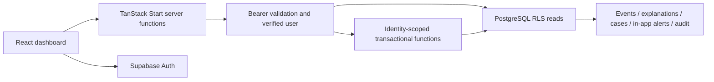
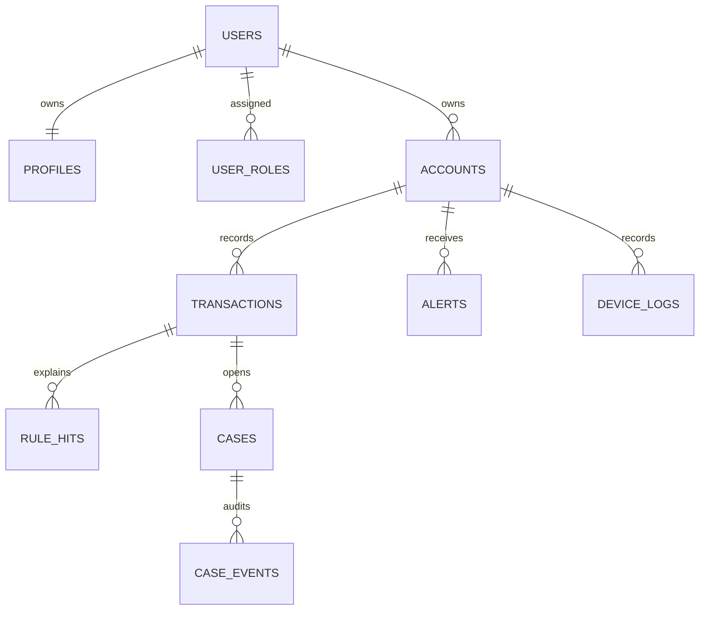

# Architecture and API

There is no stable public REST API yet. Start's generated server-function routes are framework implementation details. Every application function uses authenticated middleware; PostgreSQL enforces authorization even for direct PostgREST calls.

| Function | Input | Access and effect |
|---|---|---|
| getViewerContext | none | Own profile and roles |
| getConsoleSnapshot | none | RLS-scoped records |
| getTransactionDetail | transactionId UUID | Owned transaction, or staff |
| simulateTransaction | eventId UUID, scenario enum | Own synthetic account; atomic and idempotent |
| getAlerts | none | Own alerts, or staff |
| reviewAlert | alertId UUID, recognized/suspicious/unresolved | Owner only, audited; not bank confirmation |
| getRules | none | Authenticated read |
| setRuleEnabled | ruleId UUID, enabled boolean | Admin only, audited |
| getDeviceLogs | none | Owned account, or staff |
| getAuditTrail/getCaseDetail | none / caseId UUID | Staff-only database policy |
| updateCaseStatus | caseId UUID, status enum, optional note <=1000 chars | Staff-only atomic status and audit |

SQL RPC signatures are in the hardening migration: `simulate_bankguard_event`, `review_bankguard_alert`, `review_bankguard_case`. Synthetic scenarios are `normal`, `large_transfer`, `new_device`, `suspicious_transfer`, `unusual_hour`. Duplicate event UUIDs return the original event without rescoring. Client inputs cannot supply ownership, score, role, message recipient or delivery result.

The existing schema is retained rather than adding every future entity. OpenAPI for a stable REST interface, a documented provider adapter, CSV import and consent/revocation lifecycle remain future work. There is no bank integration and no collection of passwords, OTPs, PINs or CVVs.
